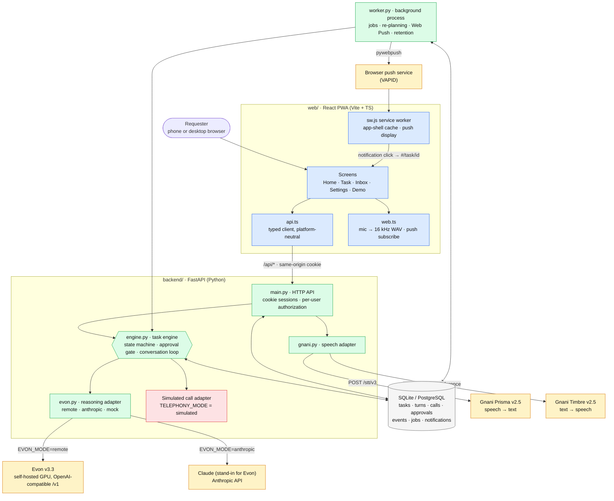
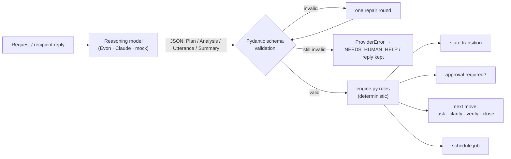
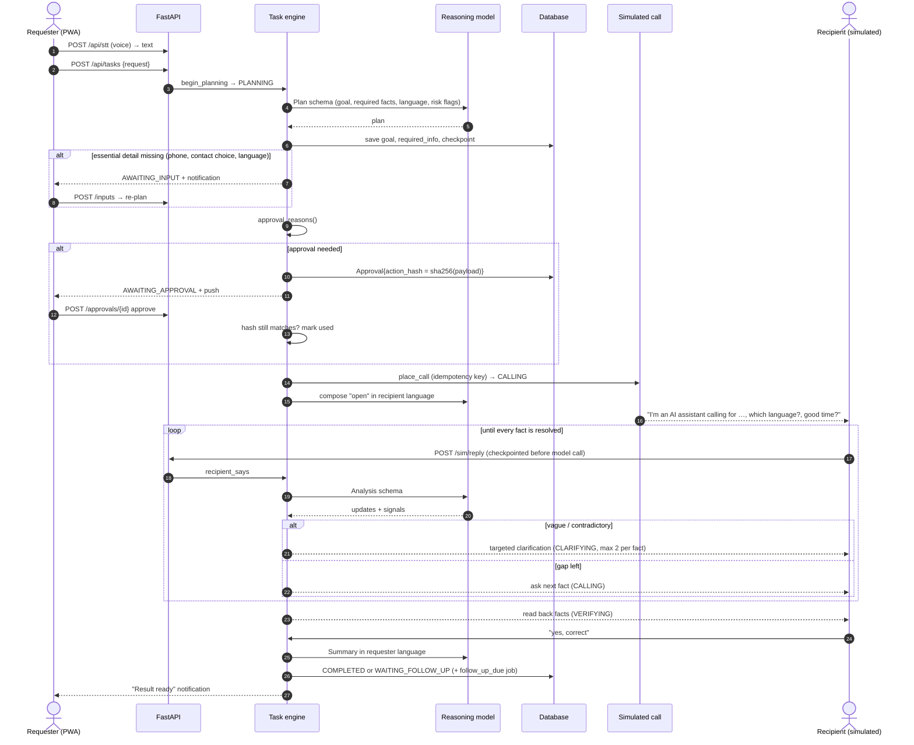
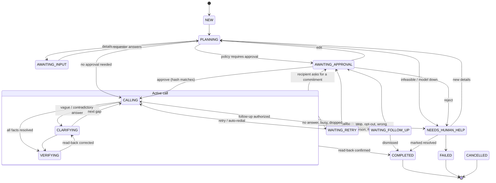
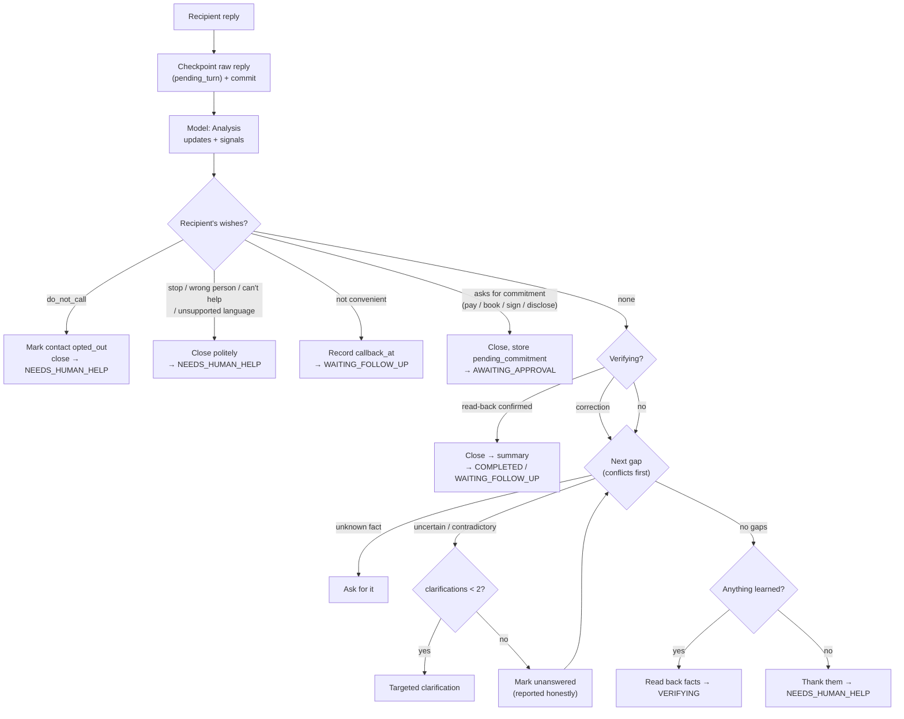
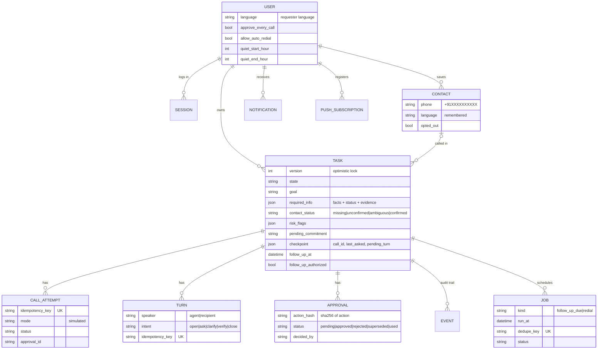
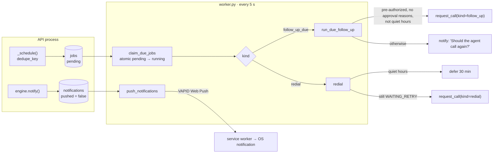
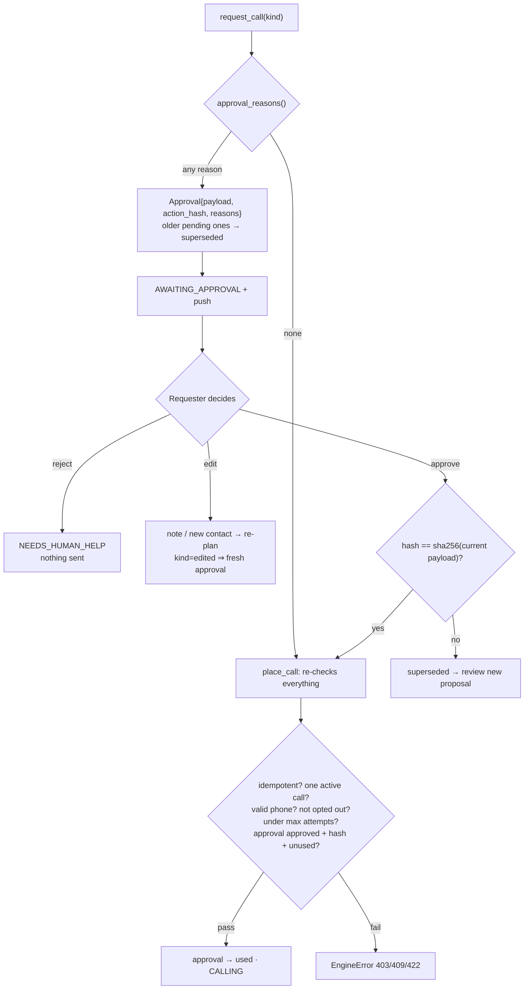
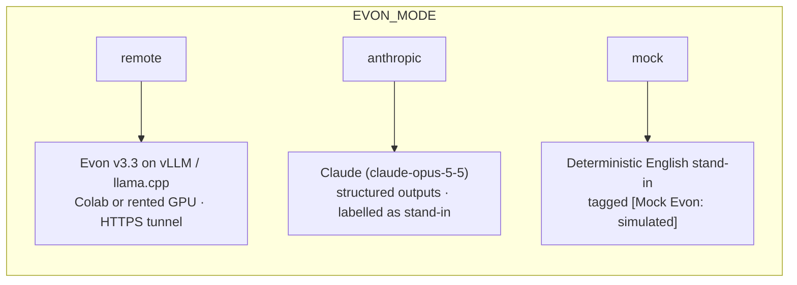

# Bolo: a multilingual AI calling agent

You tell Bolo what you need, in your own language. It works out the goal and the facts it has to collect. It phones the right person and speaks their language. When an answer is vague or contradictory, it asks a follow-up. It reads the answers back to confirm them, then reports to you in your language and says clearly which facts are confirmed, which are estimates and which are still unanswered.

It's a goal-driven task engine, not a script for one scenario. Asking a bus conductor about an arrival time, checking a delivery with a supplier and confirming an appointment with a clinic all go through the same code path.

| You (requester) | The person called (recipient) |
|---|---|
| Speak or type a request in any of 10 Indian languages | Hears an AI assistant that says it's an AI and why it's calling |
| Approve, edit or reject each proposed call | Is asked which language they prefer, and whether now is a good time |
| Get push notifications for answers, failures and follow-ups | Gets only questions that matter for the task, plus a short read-back |
| Get the result in your language, with uncertainty stated | Can refuse, stop, ask for a callback or opt out, and is never called again after opting out |

> **Calls are simulated for now.** No telephony provider is connected yet. On a simulated call, you play the recipient by typing or speaking their replies in a clearly labelled console. The `#/demo` screen can also have Claude play the recipient. Every call record is stored with `mode = "simulated"`, and nothing is ever presented as a real phone call.

---

## The four features

Everything in the product serves one of these four features:

| # | Feature | Where it lives |
|---|---|---|
| 1 | **Adaptive conversation and intelligent follow-up.** It plans the goal and the facts it needs, judges every answer, clarifies vague or contradictory ones, and verifies by reading back. | `engine.py`: `run_planning`, `recipient_says`, `_apply`, `compose` |
| 2 | **Persistent task memory and recovery.** State, checkpoints, turns, calls and audit events are stored in the DB. Calls resume without repeating answered questions. | `db.py`, `engine.py`: `transition`, checkpoints, idempotency keys |
| 3 | **Proactive notifications and conditional follow-ups.** A durable job table and a worker process handle these, delivered by Web Push. | `worker.py`, `engine.py`: `run_due_follow_up`, `call_outcome` |
| 4 | **Human-in-the-loop approval.** The backend enforces each approval, binds it to a hash of the exact action, and allows it to be used once. | `engine.py`: `approval_reasons`, `decide_approval`, `place_call` |

---

## Architecture



<sub>🟦 browser (PWA) · 🟩 this repo's backend processes · ⬜ database · 🟨 external AI and push services · 🟥 simulated, clearly labelled</sub>

| Component | What it does | Code |
|---|---|---|
| **PWA client** | Voice or text task entry, approval actions, live task status, inbox, settings. It holds no secrets and makes no authorization decisions. | `web/src/*.tsx` |
| **API client** | Typed, platform-neutral fetch layer, so it can be reused by the later React Native app | `web/src/api.ts` |
| **Web-only layer** | Records the microphone as 16 kHz WAV (Prisma doesn't accept WebM), registers the service worker, subscribes to push | `web/src/web.ts` |
| **Service worker** | Caches only the app shell, so private `/api` responses are never cached. Shows push notifications and opens the related task. | `web/public/sw.js` |
| **HTTP API** | Auth (scrypt passwords, httpOnly session cookies). Every task route checks that the task belongs to you. Maps `EngineError` to HTTP status codes. | `backend/app/main.py` |
| **Task engine** | All decisions: validated state transitions, planning, contact resolution, the approval gate, the conversation loop, call outcomes, follow-ups, cancel and take-over | `backend/app/engine.py` |
| **Reasoning adapter** | One `ask_json(system, user, schema)` call, backed by remote Evon, Claude, or a labelled mock. Output is schema-validated, with one repair round and then a loud failure. | `backend/app/evon.py`, `claude_llm.py` |
| **Speech adapter** | Prisma v2.5 STT and Timbre v2.5 TTS, one voice per language, with bounded retries | `backend/app/gnani.py` |
| **Worker** | A separate process that polls the DB every 5 s. It runs due jobs, re-plans tasks stuck in planning, delivers Web Push and purges expired data. | `backend/app/worker.py` |
| **Database** | The single source of truth. Task state never lives only in model context. | `backend/app/db.py` |

### Model proposes, code decides



The model never transitions state, places a call or grants an approval. It only returns structured proposals, such as a plan, a judgement of each answer (`confirmed`, `estimate`, `uncertain` or `refused`, quoting the recipient's words as evidence) and signals (`stop_requested`, `do_not_call`, `not_convenient`, `commitment_requested`, …). `engine.py` decides what happens next.

---

## A task, step by step



---

## Task state machine

Every transition goes through `engine.transition()`, which checks it against the `TRANSITIONS` table and writes an audit `Event`.



<sub>Every non-terminal state can also move to `CANCELLED`. `COMPLETED`, `FAILED` and `CANCELLED` are terminal and are purged after `RETENTION_DAYS`.</sub>

---

## Feature 1: the conversation loop

For each recipient reply, `_apply()` runs these rules in this order:



Each fact in `required_info` ends up with one of these statuses: `confirmed`, `estimate`, `uncertain`, `refused` or `unanswered`. It also keeps the recipient's exact words as `evidence`. The summary prompt has to keep these statuses separate, and it states that the call was simulated.

---

## Feature 2: memory, recovery and duplicate prevention



| Risk | Safeguard |
|---|---|
| The model fails mid-reply | The raw reply is saved as a turn and checkpointed (`pending_turn`) **before** the model call. Resending with the same idempotency key resumes processing. |
| A duplicate request or double-click | `CallAttempt.idempotency_key` and `Turn.idempotency_key` are unique. A repeated key returns the existing record. |
| Two calls at once | `place_call` refuses if any call on the task is `in_progress` |
| Concurrent writers | The `Task.version` column is used for optimistic locking, so a stale write fails instead of overwriting newer data |
| A call drops mid-way | Answered facts stay resolved. The next call opens with a `resume` move and asks only about the remaining gaps. |
| The API dies during planning | The worker re-runs planning for tasks stuck in `PLANNING` for over 5 minutes |
| Too much stored data | No audio is stored, and TTS is generated on demand. Terminal tasks and old notifications are purged after `RETENTION_DAYS`. You can delete any task. |

---

## Feature 3: notifications and conditional follow-ups



- **Events that notify you:** input needed, approval needed, call failed or dropped, result ready, call ended, follow-up due, and scheduled action failed.
- **Promises become jobs.** If the recipient says "I'll deliver by 5 PM", that becomes `follow_up_at` plus a `follow_up_due` job. When it's due, the worker either asks you whether to call again, or calls only if you pre-authorized it and no approval rule applies.
- **Bounded redials.** The agent gives up after `MAX_CALL_ATTEMPTS` consecutive failures. Backoff comes from `REDIAL_BACKOFF_SECONDS`. Auto-redial runs only if you turn it on **and** turn off approve-every-call.
- **Crash safety.** A job is marked `done` *before* it acts, so a worker crash can't redial twice. Retryable provider errors are retried up to 3 times. After that you get a "needs help" notification.

---

## Feature 4: the approval gate



Approval is required when any of these is true:

- your settings require approval before every call
- the number isn't in your saved contacts
- more than one saved contact matches
- a risk flag is set (`financial`, `booking_change`, `contractual`, `sensitive_personal_info`)
- the recipient asked for a commitment mid-call
- the follow-up isn't pre-authorized
- an auto-redial is due while redial is off
- you edited the plan

An approval covers the exact action: the phone number, goal, language, the questions to ask and the commitments. If any of these changes, the hash changes and a new approval is needed. You can also **cancel** a task or **take over** manually at any time. Either one hangs up an active call, cancels its jobs and supersedes pending approvals.

---

## Gnani AI models

Verified against `docs.gnani.ai` and the Hugging Face model card, Oct 2026.

| Model | Role | How it's called | Config |
|---|---|---|---|
| **Prisma v2.5** | Speech to text: your voice requests, and recipient replies in the simulator | `POST {GNANI_BASE_URL}/stt/v3`, multipart, header `X-API-Key-ID`. Leaving out `model` selects v2.5. Audio up to 30 s, as WAV. | `GNANI_API_KEY` |
| **Timbre v2.5** | Text to speech: agent lines and your result ("Listen") | `POST {GNANI_BASE_URL}/api/v1/tts/inference`, `model: timbre-v2.5`, one catalog voice per language. Text is written to match the voice's grammatical gender. | `GNANI_API_KEY` |
| **Evon v3.3** | Planning, judging answers, wording, summaries | Open weights (`gnani/gnani-evon-v3.3-30B-A3B`). Gnani doesn't host it, so you serve it on a GPU behind an OpenAI-compatible `/v1` with a bearer key. | `EVON_MODE=remote`, `EVON_BASE_URL`, `EVON_MODEL_NAME`, `EVON_API_KEY` |



- **Serving Evon:** the BF16 weights are 63.5 GB, so the official build needs an 80 GB GPU. On a free Colab T4, use the community 4-bit GGUF on llama.cpp. Step-by-step: [deploy/EVON_REMOTE_GPU.md](deploy/EVON_REMOTE_GPU.md). Check the connection with `python -m app.evon`, or in the app under Settings → Service status.
- **Claude stand-in (current setup):** `EVON_MODE=anthropic` with `ANTHROPIC_API_KEY`. Planning runs at `medium` effort and everything else at `low`. The UI says Claude is standing in, so it's never presented as Evon.
- **Supported languages** are the languages that both Prisma v2.5 and Timbre v2.5 support: en, hi, gu, ta, te, kn, ml, mr, bn and pa (`-IN`).
- If a key is missing or the Evon server is down, the API returns 503 with the reason and the UI shows it. Outside the labelled mock mode, nothing is faked.

---

## Repository layout

```
backend/                 FastAPI + SQLAlchemy (Python venv in backend/.venv)
  app/main.py            HTTP API: auth, tasks, approvals, simulator, speech, notifications, push
  app/engine.py          task engine: state machine, planning, approval gate, conversation loop, follow-ups
  app/db.py              models: users, contacts, tasks, calls, turns, approvals, events, jobs, notifications
  app/worker.py          durable worker: follow-ups, redials, re-planning, Web Push, retention purge
  app/evon.py            Evon client (OpenAI-compatible), MockEvon, health check, mode switch
  app/claude_llm.py      Claude stand-in for Evon (EVON_MODE=anthropic)
  app/gnani.py           Prisma v2.5 STT + Timbre v2.5 TTS, languages, voices
  app/config.py          settings from .env (server-side only)
  tests/                 71 tests: engine, adapters + API auth, remote Evon errors, Claude stand-in, voices
web/                     Vite + React + TypeScript PWA
  src/api.ts             platform-neutral client + types (reused by React Native later)
  src/web.ts             web-only: recorder, service worker, push
  src/Home.tsx           voice/text task entry, task list
  src/TaskView.tsx       status, approvals, simulated-call console, result
  src/Settings.tsx       language, approval and redial preferences, quiet hours, service status
  src/Demo.tsx           one-screen recording demo (#/demo)
  public/sw.js           service worker; public/manifest.webmanifest
deploy/EVON_REMOTE_GPU.md  running Evon v3.3 on a Colab / rented GPU
```

---

## Configuration

Copy `.env.example` to `.env` in the project root and fill it in. **Never commit `.env`.** All secrets stay on the backend.

| Variable | Purpose |
|---|---|
| `GNANI_API_KEY`, `GNANI_BASE_URL` | Gnani hosted Prisma (STT) and Timbre (TTS) |
| `EVON_MODE` | `remote` (Evon server) · `anthropic` (Claude stand-in) · `mock` (labelled, offline) |
| `EVON_BASE_URL`, `EVON_MODEL_NAME`, `EVON_API_KEY` | Your Evon server's public HTTPS `/v1`, served model name and bearer key |
| `EVON_DISABLE_THINKING`, `EVON_TIMEOUT` | Turn off reasoning traces (vLLM/SGLang). Per-request timeout: keep it under 100 s behind a quick tunnel. |
| `ANTHROPIC_API_KEY`, `CLAUDE_MODEL`, `CLAUDE_TIMEOUT` | Claude stand-in. Also used by the `#/demo` simulated recipient. |
| `DATABASE_URL` | `sqlite:///./agent.db` (dev) or `postgresql+psycopg://…` |
| `COOKIE_SECURE`, `SESSION_DAYS` | Set `COOKIE_SECURE=true` when serving over HTTPS |
| `RETENTION_DAYS` | Purge terminal tasks and old notifications after this many days |
| `MAX_CALL_ATTEMPTS`, `REDIAL_BACKOFF_SECONDS` | Bounded redials, e.g. `3` and `120,600` |
| `VAPID_PUBLIC_KEY`, `VAPID_PRIVATE_KEY`, `VAPID_SUBJECT` | Web Push. Generate them with `python -m app.worker --gen-vapid`. |

---

## Running

```powershell
copy .env.example .env                      # fill in keys locally
cd backend
python -m venv .venv
.venv\Scripts\pip install -r requirements.txt
cd ..\web
npm install
```

Run three processes:

```powershell
cd backend; .venv\Scripts\uvicorn app.main:app --port 8000     # API
cd backend; .venv\Scripts\python -m app.worker                 # scheduler / push / retention
cd web; npm run dev                                             # http://localhost:5173 (proxies /api)
```

On a phone, the microphone and Web Push need HTTPS. Use `npm run build && npm run preview` behind an HTTPS tunnel, and set `COOKIE_SECURE=true`. On iOS, Web Push works only for an installed PWA (iOS 16.4+).

---

## Testing

```powershell
cd backend; .venv\Scripts\python -m pytest -q     # 71 tests, offline (HTTP and models mocked)
```

These cover:

- state transitions and illegal moves
- planning and missing inputs
- contact ambiguity
- approval binding, rejection, editing and single use
- vague answers leading to clarification, plus the clarification cap
- contradictions
- read-back verification
- drop-and-resume without re-asking
- idempotent replies and calls
- bounded redials
- follow-up scheduling, dismissal and quiet hours
- opt-out, stop and commitment requests
- cancel and take-over
- per-user authorization
- Evon error mapping and the Claude adapter

---

## Demo script (simulation)

1. Sign up, choose your language (e.g. Gujarati), and keep "Ask me before every call" on.
2. Speak or type: *"Call the conductor on +91 98765 43210 and ask when bus 21G reaches Guindy."* Leave the language as "Not sure". The model should infer Tamil from context or ask you.
3. Approve. The reasons shown are your setting and the new number. The agent opens in Tamil, introducing itself as an AI assistant.
4. As the conductor, reply *"பஸ் பக்கத்துல இருக்கு"* ("the bus is nearby"). The agent asks a targeted follow-up about the number of minutes. Reply *"சுமார் 15 நிமிஷம்"* ("about 15 minutes"). It reads that back; confirm it. You get the result in Gujarati, marked as an **estimate**.
5. To test recovery, click **Drop the call** mid-conversation, then **Call again**. The new call resumes without repeating answered questions.
6. Other paths to try: *"I'll confirm by 5 PM"* schedules a follow-up, *"don't call me again"* marks the contact as opted out, and asking the agent to pay pauses the call for your approval.

For a hands-free recording, open `#/demo`. Claude plays the recipient and speaks with a second Timbre voice. The agent side is still the real engine.

---

## Status and known limitations

- **Real telephony:** not integrated. The next step is a provider with outbound calls, bidirectional media streaming and status webhooks (e.g. Twilio Media Streams, or Exotel for India), wired to `place_call` and `call_outcome`. That needs an account, a public HTTPS URL, and checks on regional calling and consent rules.
- **Live end-to-end with real Evon:** not run, because no GPU was available. The remote client, error mapping and health check are tested with mocked HTTP. The Colab steps follow the official model card. Latency, quality and credit usage still need measuring.
- **Phone numbers:** only Indian numbers (10 digits, normalized to `+91…`).
- **PostgreSQL:** the code is dialect-neutral, but only SQLite has been tested.
- **Native app:** not started. React Native comes after the web version is stable.
